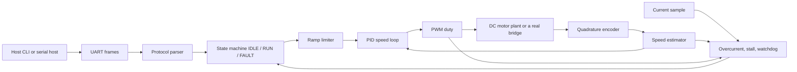

# Embedded motor speed controller

Portfolio demo for [Arpan Bom](https://github.com/applycoding) (`applycoding`).

This is a simulated microcontroller project: a C++17 speed loop written the way it would sit on an STM32 or RP2040, with the PWM, quadrature encoder, and UART replaced by host implementations. **Nothing here drives a real motor.** There is no board support package, no flashing step, and the default build never touches hardware. The plant is a DC motor model on your PC.

The control path does not allocate. `SpeedController::tick()` uses the stack and fixed buffers only (no `new`, no `std::string`, no `std::vector`).

## Architecture



| Piece | Role |
| --- | --- |
| `hal::Pwm`, `hal::Encoder`, `hal::Uart` | Hardware interfaces. The sim classes in `motor::sim` implement them for the host. |
| `SpeedEstimator` | Count delta to RPM, with a first-order low pass. Wrap uses unsigned subtraction. |
| `RampLimiter` | Caps command slope so a step setpoint cannot slam the bridge. |
| `Pid` | Float PID. The integrator freezes on the rail (clamping anti-windup) and still unwinds when the error reverses. |
| `FaultDetector` | Overcurrent, and stall (high duty, near-zero speed) while the axis is in `RUN`. |
| `Watchdog` | Trips if `RUN` sees no `SET_RPM` or `PING` for N control ticks. `GET_STATUS` does not kick it. |
| `StateMachine` | `IDLE`, `RUN`, `FAULT`. The first fault code sticks until `CLEAR_FAULT`. |
| `DcMotorPlant` | RL electrical model plus inertia and viscous friction, for the host CLI. |

## Layout

```text
include/motor/     public headers (HAL, loop, protocol)
src/               core, sim HAL, plant
sim/main.cpp       CSV telemetry CLI
tests/             GoogleTest: PID, protocol, state machine
cmake/arm-none-eabi.cmake
```

## Build on the host

```bash
cmake -S . -B build -DCMAKE_BUILD_TYPE=Release
cmake --build build
ctest --test-dir build --output-on-failure
./build/motor_sim --rpm 1200 --seconds 1.5 --csv telemetry.csv
```

`motor_sim` sends checksummed `START` and `SET_RPM` frames into the simulated UART, runs the loop at 1 ms, steps the plant, and writes:

```text
t_s,rpm_cmd,rpm_meas,duty,current_a,mode,fault
```

It also refreshes `SET_RPM` every 100 ticks so the command watchdog stays satisfied. Defaults match a small 12 V motor: 1200 rpm is about duty 0.13 in steady state. Gains in `sim/main.cpp` are illustrative, not a tuned production loop.

## Serial protocol

Lines end with `\n` (`\r` is ignored). The checksum is the XOR of the payload bytes, sent as two uppercase hex digits:

```text
<payload>*<HH>\n
```

| Payload | Meaning |
| --- | --- |
| `START` | `IDLE` to `RUN`. Refused in `FAULT`. |
| `STOP` | `RUN` to `IDLE`. PWM goes to zero. |
| `SET_RPM <int>` | Speed target. Refused in `FAULT` and outside the configured limit. Kicks the watchdog. |
| `GET_STATUS` | Does not kick the watchdog. |
| `CLEAR_FAULT` | `FAULT` to `IDLE`. |
| `PING` | Kicks the watchdog. |

Known vectors:

```text
PING*10
SET_RPM 1200*71
GET_STATUS*1D
```

Replies use the same framing: `OK`, `ERR bad_checksum`, `ERR bad_frame`, `ERR bad_arg`, `ERR unknown_command`, `ERR fault`, `ERR state`, or

```text
STATUS <MODE> <FAULT> <target_rpm> <measured_rpm> <duty>
```

Example: `STATUS RUN NONE 1200.0 1198.9 0.126`

## Cross compiling the core

The core is portable C++17 and can be built with `-fno-exceptions -fno-rtti`. The ARM file targets a Cortex-M4 with the soft float ABI and produces a static library, not a linked image.

```bash
cmake -S . -B build-arm \
  -DCMAKE_TOOLCHAIN_FILE=cmake/arm-none-eabi.cmake \
  -DMOTOR_BUILD_TESTS=OFF -DMOTOR_BUILD_SIM=OFF
cmake --build build-arm
```

You need `arm-none-eabi-g++` (`gcc-arm-none-eabi` on Debian/Ubuntu). Link `libmotor_core.a` into your own startup code.

To drop it into an STM32Cube or RP2040 project:

1. Compile this library with the toolchain file (STM32) or add the `src/*.cpp` files and `include/` to your Pico SDK target.
2. Implement `hal::Pwm`, `hal::Encoder`, and `hal::Uart` on top of a timer PWM plus direction pin, a quadrature timer or PIO, and a USART.
3. Call `SpeedController::tick(dt, current_a)` from a 1 kHz timer. Pass a current sample from the ADC (or `0` if you have no sensor yet; overcurrent will stay quiet and stall detection still works).
4. Keep the tick function on the stack. Do not call `malloc` from that path.

A Pico SDK target would look like a normal `pico_sdk_import` project that lists these sources and links `pico_stdlib` plus `hardware_pwm` / `hardware_uart`. That SDK is external, so it is not vendored here.

## Tests and CI

GoogleTest covers the PID (including anti-windup), the protocol parser and checksum, and the state machine. GitHub Actions builds the host library, runs those tests, and cross-compiles the core with `arm-none-eabi-g++`.

## License

MIT. See [LICENSE](LICENSE).
